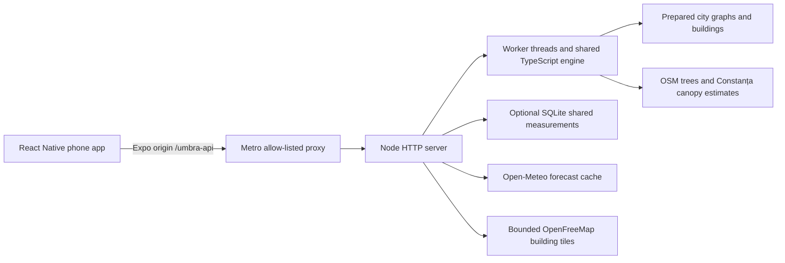

# Umbra project guide

Documentation checked against the repository on 29 October 2026.

Umbra compares walking routes using estimated urban shade, departure time and
an accepted detour. Its mobile application also estimates building heights from
measured shadow lengths and feeds confirmed height ranges back into the shadow
and route models. Constanța is the original research area.

## Start the application

Requirements: Node.js 22.13 or newer, npm, and Expo Go compatible with Expo SDK 58
on an Android or iOS phone. Run these commands from the repository root:

```bash
npm --prefix mobile ci
npm --prefix mobile start -- --clear
```

The first command installs dependencies and builds the embedded map renderer.
The second starts the PC calculation server and Expo/Metro together. Keep it
running, connect the phone to the same reachable network, and scan the fresh QR
code with Expo Go or the iPhone Camera app. Allow foreground location when asked.

The phone discovers the API through the Expo connection. It calls `/umbra-api`
on the Metro origin, which forwards allowed requests to `127.0.0.1:8000` on the
PC. There is no server-address field in the app. `localhost` on a phone refers
to the phone, so entering the PC's loopback address would not connect it.

For separate terminals:

```bash
# Terminal 1
npm --prefix mobile run server
```

```bash
# Terminal 2
npm --prefix mobile run metro -- --clear
```

Check readiness on the PC:

```bash
curl --fail http://127.0.0.1:8000/health
curl --fail http://127.0.0.1:8081/umbra-api/health
```

The second address assumes Metro's default port, 8081. A ready response identifies
`umbra-compute`, schema version 1 and `ready: true`. Readiness means workers have
loaded their catalogues; individual city data are loaded on first use.

If port 8000 is occupied, stop the old backend or choose another internal port:

```bash
UMBRA_COMPUTE_PORT=8001 npm --prefix mobile start -- --clear
```

The combined launcher reuses a compatible separately running server. It stops
only the processes it owns when you press Ctrl+C. A standalone app build needs
a developer-configured HTTPS API through `EXPO_PUBLIC_API_URL`; the Expo setup
is a development workflow, not a hosted deployment.

## Use the app

1. Choose a destination with **Unde mergi?** or by long-pressing the map.
2. Use **Acum** to select the departure instant and **Setări** for the maximum
   extra walking time: 0, 5, 10 or 15 minutes.
3. Compare the returned alternatives by duration, distance and modeled shade.
   A comparison can return fewer than three routes when useful distinct
   alternatives are unavailable.
4. Select a route and tap **Pornește traseul**. The app follows foreground GPS
   and shows remaining distance, time and estimated arrival. Panning suspends
   following; the location button resumes it. **Ieși** leaves navigation.
5. In **Straturi**, change map style, buildings, shadows and estimates. Lighter
   illustrative shadows and 3D display heights are separate from evidence used
   to classify route exposure. **Nori** controls the decorative weather icon;
   hiding it does not disable the forecast.

Prepared walking data and map-display coverage are different. The current
checked-in city index contains **București (9 zones) and all 40 other county
seats**: 41 cities in 49 areas. Its rectangles are the authority for routable
coverage; suburbs outside them (for example in Ilfov) and other towns have no
walking graph. See [city coverage](cities.md).

Outside prepared areas, the PC can fetch bounded OpenFreeMap building tiles
inside the Romania envelope for display and approximate shadows. These tiles
do not supply a walking graph. A visible building layer therefore does not
guarantee that a route is available there.

## Measure a building

Open **Măsoară clădirea** using the ruler button, tap an eligible OSM building,
and choose the roof corner associated with the shadow tip. Measurements require
a real corner-to-tip distance and a suitable shadow:

| Method | Input |
| --- | --- |
| Tape or laser | Measured ground distance from corner to shadow tip |
| Phone GPS | Fixes gathered at the shadow tip and projected onto the ruler line |
| Nadir drone photo | Photo time, altitude, camera dimensions and shadow length in pixels |

The model uses `h = L × tan(e)`, where `L` is shadow length and `e` is solar
elevation at the measurement instant. It propagates length, penumbra and solar
angle uncertainty. The measurement clock is distinct from the map inspection
clock. Low Sun, obstructed tips, unsuitable geometry and implausible values are
checked; slope can require review. AR measurement is not implemented.

Measurements are stored locally. A single accepted tape/laser or drone reading,
or two independent accepted readings agreeing within the model's tolerance, can
confirm a building under the software rules. Independent reference heights and
blind-study settings are retained separately. See the precise
[measurement rules](shadow-heights.md#implementation-status).

Sharing is off initially. **Setări → Contribuie la baza comună** enables upload
to the PC's shared database. The server checks the OSM building/corner,
recomputes the height and uncertainty, and publishes confirmed ranges. Users
can remove their own uploads; disabling sharing alone is not the same as
deleting earlier uploads. Keep study exports and database backups outside Git.

## Architecture



| Location | Responsibility |
| --- | --- |
| `mobile/src/app/` and `components/` | Screens and native controls |
| `mobile/src/domain/` | Request/response and measurement validation |
| `mobile/src/services/` | Discovery, HTTP calls, cancellation and sharing |
| `mobile/src/engine/` | Shared solar, metric geometry, exposure and routing calculations |
| `mobile/map-web/` | Embedded map renderer; drawing remains on the phone |
| `server/compute/` | HTTP service, workers, city catalogue, tiles and forecasts |
| `server/heights/` | Shared SQLite storage, validation and moderation |
| `scripts/` | Data preparation, research analysis and document generation |
| `server/internal/umbra/` | Separate Go preparation/reference implementation |

Workers decode a city on demand and retain a bounded cache. CPU-heavy calculation
runs outside the HTTP event loop. Request deadlines, cancellation, geometry
budgets, bounded caches and compressed responses limit work. The PC must remain
reachable for new calculations; there is no automatic phone calculation fallback.
Map rendering, GPS and compass readings remain phone tasks.

## Models and interpretation

Geometry uses projected metric coordinates (UTM 35N), with geographic coordinates
for inputs and display. Solar position uses the actual UTC instant and
NOAA/Meeus equations. Buildings are simplified vertical prisms on flat ground;
the projection, source geometry, source ages and terrain assumptions limit accuracy.

The fastest path is calculated first on the imported walking graph. A bounded
candidate search compares alternatives under the user's extra-time limit.
Exposure is sampled at estimated traversal times along each candidate. This
search does not prove a global optimum and does not create links through
buildings or fill missing walking connections.

| Exposure value | Interpretation |
| --- | --- |
| `shade` | Geometric building obstruction supported by the model's height range |
| `estimated_shade` | Modeled tree/canopy or satellite-height shade, with reduced weight |
| `unshaded_estimate` | No modeled obstruction found; incomplete mapping can change this |
| `unknown` | The model cannot classify exposure adequately |
| `sun` | Accepted contract category; absence of mapped shade alone does not establish it |

OSM height tags, floor-count estimates, Copernicus estimates, user measurements
and display-only placeholders are distinct sources. Copernicus 2012 estimates
fill eligible untagged buildings and use a heuristic −5/+10 m range, not a
statistical confidence interval. Display-only fallback volumes do not become
measured heights. Tree models simplify crown geometry and seasonal foliage.

When a usable forecast is available, Open-Meteo's hourly direct-radiation and
cloud-cover data re-rank existing alternatives. The current preference score is
walking seconds plus modeled direct-radiation exposure divided by 150 W/m².
This weighting is a model choice. The forecast uses a regional location and
does not locate individual clouds above streets. Failure or missing time
coverage leaves geometric routing available without a weather recommendation.

Neither shade nor the weather score measures personal UV dose, temperature or
medical safety. See [weather-aware routing](research/weather-aware-routing.md).

## API and configuration

The development proxy adds `/umbra-api` to these backend paths:

| Method and path | Purpose |
| --- | --- |
| `GET /health` | Identity, schema, capabilities and worker readiness |
| `POST /v1/routes/compare` | Fastest and useful distinct alternatives |
| `POST /v1/shadows` | Timestamped, bounded shadow GeoJSON |
| `POST /v1/buildings` | Bounded building geometry and height provenance |
| `POST /v1/buildings/inspect` | Measurement target and available corners |
| `GET /v1/heights?since=…` | Shared height ranges and withdrawals |
| `POST /v1/measurements` | Opt-in measurement submission |
| `DELETE /v1/measurements/{id}` | Remove an upload owned by this installation |
| `DELETE /v1/measurements` | Remove all uploads from this installation |
| `GET /v1/buildings/{way\|relation}/{id}` | Public building measurement summary |

The route request contains `schema_version`, `origin`, `destination`,
`departure_at`, `departure_timezone`, `max_extra_minutes` and
`walking_speed_mps`. Coordinates are objects with `latitude` and `longitude`.
The departure timestamp includes `Z` or a UTC offset; the timezone is an IANA
name such as `Europe/Bucharest`. Preserve the requested timestamp in the response.

For example, inspect shadows in a small prepared Constanța viewport:

```bash
curl --fail --max-time 20 \
  -H 'Content-Type: application/json' \
  --data '{"at":"2026-10-29T09:00:00Z","bounds":[28.634,44.173,28.636,44.175],"include_estimates":true}' \
  http://127.0.0.1:8000/v1/shadows
```

Shadow inspection accepts historical instants; route departure validation is
different and requires a present/future departure. Large viewports can be clipped
or truncated according to the response metadata and feature budgets.

The response contains `schema_version`, `departure_at`, `generated_at`, `method`,
`routes`, `warnings`, `attribution` and optional `weather`. Each route carries an
ID, kind, distance, duration and connected segments with coordinates, durations
and exposure categories. The authoritative contract and validators are in
[`routes.ts`](../mobile/src/domain/routes.ts); coordinate order in GeoJSON is
`[longitude, latitude]`, and viewport bounds are `[west, south, east, north]`.

| Variable | Default/use |
| --- | --- |
| `UMBRA_COMPUTE_PORT` | Internal backend port, 8000; set consistently for server and proxy |
| `UMBRA_CITY_CACHE` | Per-worker prepared-area cache size, 3 |
| `UMBRA_HEIGHTS` | Set `off` to disable shared measurement storage/API |
| `UMBRA_HEIGHTS_DB` | SQLite path; default `.umbra-data/heights.sqlite3` |
| `EXPO_PUBLIC_API_URL` | Developer override for a deployed calculation API |
| `EXPO_PUBLIC_HEIGHTS_URL` | Optional separate shared-height service |

See [server details](backend/mobile-server.md) for request budgets, worker
behavior and regional data handling.

## Data and privacy

- OSM walking graphs, footprints and trees: retain OpenStreetMap contributor
  attribution and ODbL notices with redistributed data.
- Copernicus Urban Atlas Building Block Height: retain source year and CLMS/EEA
  attribution. Old raster estimates can disagree with present buildings.
- Meta/WRI canopy estimates supplement Constanța only; they are not a tree census.
- OpenFreeMap supplies map tiles and on-demand building geometry.
- Open-Meteo supplies the regional forecast and its attribution.
- GBA is used in the research comparison, not as the current runtime height feed.
  Its research script keeps restricted per-building inputs outside Git.

See [data provenance](mobile-data.md), [city manifests](cities.md) and the source
notices in responses. Do not substitute licenses of derived datasets for their
upstream licenses.

Route endpoints, time and viewport go to the PC. These calculation requests are
not written to disk or request logs by the server; bounded result caches are
transient. Open-Meteo receives the route midpoint rounded to 0.02 degrees.
Map/search providers handle their own requests. Shared uploads include the OSM
building, corner, measurement inputs and anonymous installation ID; they do not
include the user's GPS history or photos. A building/corner still identifies a
place. Public measurement responses omit installation IDs and precise corners.

The development backend is not a hardened public hosting service. Protect shared
database backups and Copernicus credentials; `.umbra-data/` is ignored by Git.

## Research and document reproduction

The primary question, shared with the paper and poster, is:

> **Cu ce eroare estimăm înălțimea clădirilor din umbre și când rămân vârfurile umbrelor neobstrucționate?**

It has two measurable outputs: height error as a function of shadow-length and
solar-angle uncertainty, and the share of buildings whose shadow tips are not
blocked by other modeled buildings at the selected instants. The GBA/OSM
comparison identifies limitations in existing height sources. Height measurement
then supplies the application workflow: **shadow length → height range → shadow
map → route comparison**. Field reference exports support a separate measured
accuracy evaluation; the obstruction simulation alone does not establish it.

The latest application adds Copernicus 2012 estimates for eligible buildings
without OSM heights, regional Open-Meteo recommendations and a published catalogue
of 41 cities in 49 areas. Constanța has 16,243 Copernicus height estimates in the
current index. This is a count of available estimates, not an accuracy result.
OSM tags and confirmed measurements retain priority. The regional forecast does
not model cloud shadows street by street.

The [GBA analysis](research/gba-heights/README.md) and
[`paper/measurability.json`](paper/measurability.json) supply the paper/poster
figures. The original Constanța analysis reports 51,428 OSM building footprints,
4,925 GBA/floor-count associations and a 38,913-building simulation. These are
different samples and dated source snapshots, not an inventory of field readings.

The research scripts describe their dependencies and exact input arguments in
their module docstrings:

| Script | Input and output |
| --- | --- |
| `scripts/compare-gba-heights.py` | External GBA tile → aggregate comparisons and figures |
| `scripts/shadow-measurability.py` | Per-building analysis CSV → simulated shadow-tip availability |
| `scripts/analyze-shadow-heights.py` | App study exports and independent references → error statistics |
| `server/compute/route-effect.mjs` | Configured trips, times and height sources → modeled route-effect analysis |
| `scripts/build-paper.py` | Competition Word model and tracked research outputs → paper DOCX |

For actual study exports:

```bash
uv run --python 3.12 --with numpy==2.3.4 --with matplotlib==3.10.7 \
  python scripts/analyze-shadow-heights.py /path/to/results \
  /path/to/export1.json /path/to/export2.json
```

Keep exports, raw imagery, source downloads and databases outside Git. Use the
[city rebuild instructions](cities.md#rebuild) only when changing prepared data;
running the application does not require a fresh import.

The current [paper PDF](paper/umbra-lucrare.pdf) and
[Word source](paper/umbra-lucrare.docx) are separate from the
[editable Canva poster and print source](poster/scientific/README.md). Follow
the poster instructions to identify its current design; older similarly named
Canva designs and camera-project paperwork are historical.

The 29 October poster places the research question beneath the masthead and
explains these current app features alongside the study figures. Its editable
Canva source contains 126 text elements and separate vector graph components;
the illustration and repository QR code are the two images. The current print
file is 80 × 120 cm, portrait, as required by RoSEF 2026 Article 6(4) II. The separate [project documentation PDF](documentation/umbra-documentatie.pdf)
is five A4 pages in black and white. The paper remains five A4 pages and includes the
Copernicus/Open-Meteo sources without replacing the original study results.

## Checks and troubleshooting

```bash
npm --prefix mobile run typecheck
npm --prefix mobile run lint
npm --prefix mobile test
npm --prefix mobile run test:server
npm --prefix mobile run export:android
npm --prefix mobile run export:ios
```

The suites cover contracts, synthetic geometry, solar references, routing,
measurement rules, workers and real prepared data. Platform exports verify
bundling. Those checks do not measure walking benefit, field height accuracy,
GPS/compass behavior or phone frame rate. The team reports field use in Constanța;
quantitative field claims require the corresponding study records. Historical
test runs and their scope are in [verification](mobile-verification.md).

For this documentation revision, the server launcher was exercised on Node
22.23.2 using an isolated port with shared storage disabled. `/health` returned
`ready: true` and the shadow-inspection request above returned GeoJSON. No
physical-phone checks or new field measurements were performed for this revision.

| Symptom | Action |
| --- | --- |
| **Repornește serverul de pe PC** | Stop the old backend, restart the combined launcher, reload Expo Go |
| Phone cannot connect | Keep the PC running; check Wi-Fi reachability, Metro address and firewall |
| **Outside prepared data** or no route | Check the city index, graph connectivity and endpoint distance from a walking edge |
| No daylight shadows | Check selected time, Sun elevation, enabled layers and source heights |
| Weather unavailable | Check internet and forecast time coverage; geometric routing remains available |
| Map renderer looks stale | Fully reload Expo Go after a renderer update |

After intentionally changing `mobile/map-web/map.js`, developers rebuild the
embedded renderer with `npm --prefix mobile run build:map`. This guide does not
require changes to mobile dependencies or the Expo SDK.
