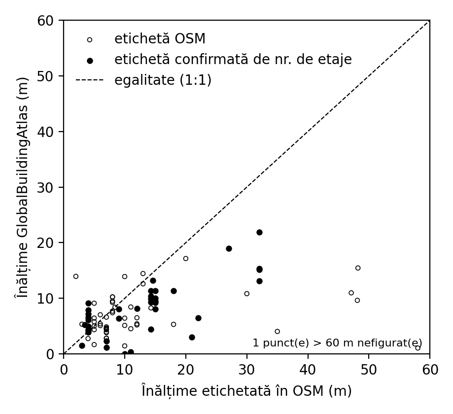
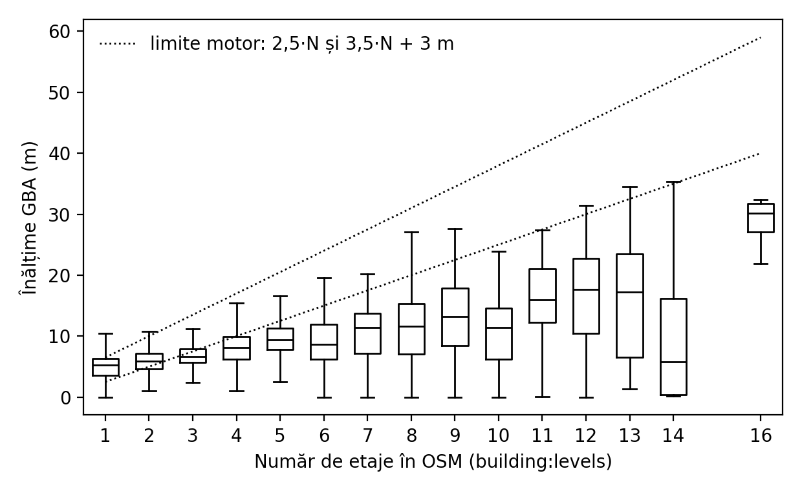

# GlobalBuildingAtlas heights vs OSM in Constanța

Baseline check for the shadow-height research: how good are the global machine-learning heights from GlobalBuildingAtlas (GBA) [1] for the buildings in the bundled city data? Run on 27 October 2026 with [`scripts/compare-gba-heights.py`](../../../scripts/compare-gba-heights.py). Aggregate numbers are in [`summary.json`](summary.json).

## Data

- **GBA:** `LoD1/europe/e025_n45_e030_n40.json` from [huggingface.co/datasets/zhu-xlab/GBA.LoD1](https://huggingface.co/datasets/zhu-xlab/GBA.LoD1), SHA-256 `10a2dc40b865ff1792484c0b2af4c5ef5f825055efd5134e88421de21dc8ba7b`, CC BY-NC 4.0. Keys are `osm<way id><ISO3>`, so buildings are matched by OSM way id, without any geometric matching. The 71 relations are skipped because their ids could collide with ways that have the same number. Per-building GBA values are not committed.
- **OSM:** the bundled `constanta-city-v1` snapshot, with heights classified exactly as in `buildingHeight()` (`mobile/src/engine/data.ts`).

## Results

**Coverage.** 40,658 of 51,428 buildings (79.1%) have a GBA height, including 35,575 of the 45,159 buildings with no OSM height. Of the 10,699 unmatched ways, 9,962 are newer than the newest matched way, so GBA was built from an older OSM snapshot. This is also why only 88 of the 271 height-tagged buildings match: most tags were added recently.

**Against OSM height tags (n = 88).** Bias −8.1 m, median absolute error 3.7 m, 43% within ±3 m, Pearson r = 0.26. The RMSE of 27.9 m is driven by a few implausible tags, such as a 250 m tag on a 252 m² industrial footprint. In the 37 buildings whose height tag agrees with their floor count (2.5–4.5 m per floor): bias −5.0 m, MAE 6.1 m, 32% within ±3 m.

| OSM tag | n | Bias (m) | MAE (m) | Within ±3 m |
| --- | ---: | ---: | ---: | ---: |
| 0–10 m | 45 | −0.1 | 2.3 | 71% |
| 10–20 m | 28 | −5.1 | 5.5 | 18% |
| 20–40 m | 10 | −15.7 | 15.7 | 10% |

**Against floor counts (n = 4,925).** A floor count is not a measured height, so these are consistency checks only. Implied height per floor falls as buildings get taller: 3.96 m (1–2 floors), 2.14 m (3–4), 1.79 m (5–8), 1.36 m (9–12). Real floors are not 1.4 m tall, so GBA strongly underestimates the tall blocks. Only 4.2% of 9–12-floor buildings fall inside the engine's own floor bounds of 2.5·N to 3.5·N + 3 m.

## Interpretation and limits

GBA is usable for low buildings (≤ 10 m) but systematically underestimates Constanța's apartment blocks, roughly halving 9–10-floor blocks. Those blocks cast most of the useful street shade. Using GBA to fill missing heights would therefore shorten exactly the shadows that matter. This underestimation of tall buildings agrees with reports from other regions.

The reference heights are volunteered OSM tags and floor counts, not surveyed heights. OSM tags include obvious errors, and the tagged sample is small and recent. The meaning of the GBA `var` field was not verified. A surveyed reference set, such as laser-rangefinder measurements, is needed before reporting absolute accuracy. That is exactly the field data the shadow method has to collect anyway.

[1] Zhu, X. X., Chen, S., Zhang, F., Shi, Y., Wang, Y., „GlobalBuildingAtlas: an open global and complete dataset of building polygons, heights and LoD1 3D models", *Earth System Science Data*, 17(12), 2025, pp. 6647–6668. https://doi.org/10.5194/essd-17-6647-2025
